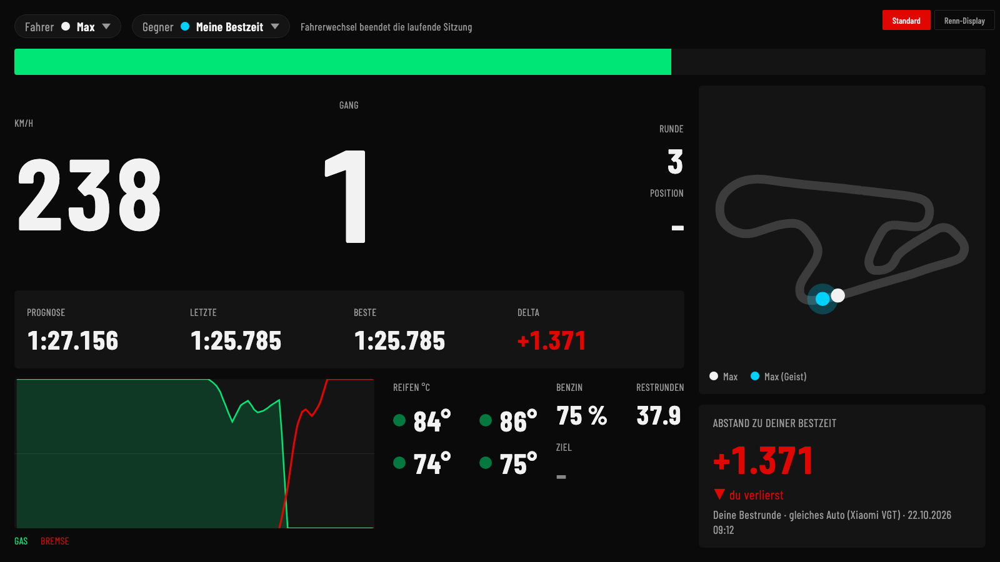
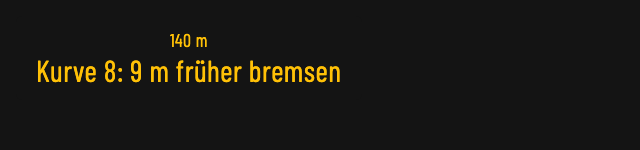
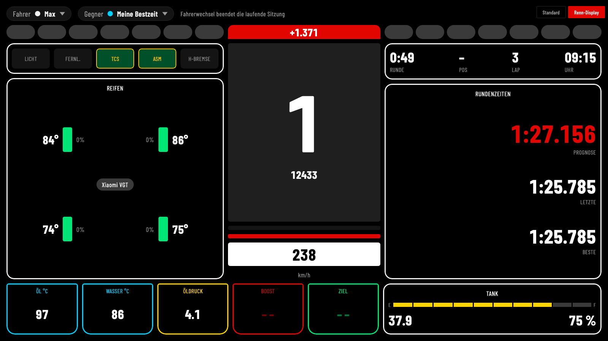
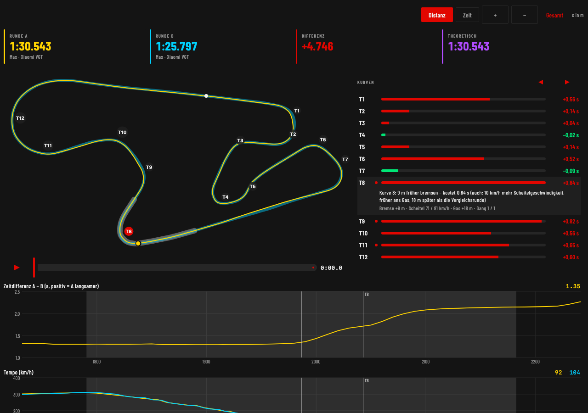
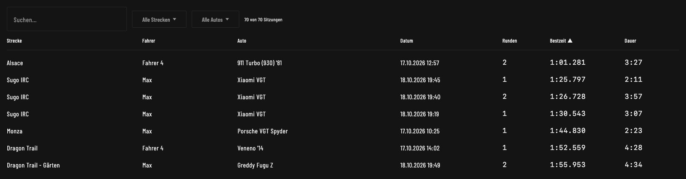

# GT7 Dashboard

App für Gran Turismo 7 auf macOS, Windows und Android (Kotlin Multiplatform + Compose): Live-Telemetrie von der PS5, Rundenerkennung, Analyse mit Renningenieur, Charts und Streckenkarte. Downloads unter [Releases](https://github.com/kmaxk/gt7-dashboard/releases).

## Überblick

### Live-Dashboard

Tempo, Gang mit Schaltblitz, Prognose und Delta zur Referenzrunde, Gas- und Bremsverlauf, Reifen, Benzin mit Restrunden – und die Streckenkarte mit dem Geist der Referenzrunde.



**Live-Tipps:** Nach jeder Runde merkt sich der Renningenieur die Kurven, die gegenüber der Referenzrunde Zeit gekostet haben. In der nächsten Runde blendet er vor der Kurve einen Tipp ein – auf Wunsch liest er ihn auch vor (macOS und Android, Stimme in den Einstellungen wählbar).



Das **Renn-Display** zeigt dasselbe groß und kontrastreich, mit Fahrhilfen, Öl- und Wassertemperatur und Tank:



### Analyse-Cockpit mit Renningenieur

Oben die Kernzahlen (Runde A, Runde B oder automatische Vergleichsrunde, Differenz, theoretische Bestzeit). Darunter die Ideallinie mit Wiedergabe und daneben die **Kurvenliste**: jede Kurve mit ihrem Zeitverlust, die drei teuersten rot markiert; die gewählte Kurve klappt auf und erklärt, was sie kostet. Mit ◀ ▶ oder den Pfeiltasten geht es Kurve für Kurve durch die Runde, Karte und Diagramme zoomen mit. Darunter Delta, Tempo und Gas/Bremse mit gemeinsamem Cursor; Gang, Drehzahl, Ladedruck und Rollen sind eingeklappt.



### Sitzungen

Alle Sitzungen mit Suche, Strecken- und Autofilter und sortierbaren Spalten. Sitzungen lassen sich umbenennen und löschen, Runden als Referenz markieren und als CSV/JSON exportieren; die Rundentabelle zeigt Vmax, Sektorzeiten und die theoretische Bestzeit.



Die Bilder stammen aus echten Runden; das Live-Dashboard zeigt eine davon als Wiedergabe.

## Starten

```
./gradlew :desktopApp:run
```

## macOS-Paket (DMG)

`jpackage` muss im Gradle-JDK vorhanden sein (die JBR von Android Studio hat es nicht), z. B. mit einem Temurin-JDK:

```
./gradlew -Dorg.gradle.java.home=<pfad-zu-jdk-mit-jpackage> :desktopApp:packageDmg
```

Ergebnis: `desktopApp/build/compose/binaries/main/dmg/GT7 Dashboard-1.0.0.dmg` (macOS verlangt eine Bundle-Version ≥ 1, daher intern 1.0.0; die Release-Version steht in `packageVersion`)

## Windows-Installer (MSI)

Wird von GitHub Actions (`.github/workflows/release.yml`) auf einem Windows-Runner gebaut, sobald ein Release veröffentlicht wird – ebenso das DMG. Lokal unter Windows:

```
./gradlew :desktopApp:packageMsi
```

## Android

Die App läuft auf Smartphones und Tablets (Android 8 oder neuer, Querformat). Die signierte `GT7-Dashboard-<version>.apk` im Release ist **pausiert**, bis die Signierung eingerichtet ist (siehe unten); bis dahin lokal bauen.

- **Installieren:** APK auf dem Gerät öffnen und „Unbekannte Apps installieren“ für den Browser bzw. die Dateien-App erlauben.
- **Daten übertragen:** am Rechner *Einstellungen → Daten → Exportieren…* (z. B. in den Drive- oder Nextcloud-Ordner), auf dem Gerät *Importieren…* – und umgekehrt.
- **Mitschnitte** liegen auf Android in einem privaten Ordner; nach „Mitschnitt stoppen“ fragt die App, wohin eine Kopie gespeichert werden soll.
- **Parallelbetrieb** mit der Desktop-App: noch nicht geprüft, ob die PS5 an zwei Empfänger gleichzeitig sendet.

Lokal bauen (Android-SDK nötig, Pfad in `local.properties`; auch der Desktop-Build braucht seit dem Android-Modul ein SDK):

```
./gradlew :androidApp:assembleDebug
./gradlew :androidApp:connectedDebugAndroidTest   # mit Gerät oder Emulator
```

**Signatur für Releases (einmalig):**

```
keytool -genkeypair -v -keystore release.jks -alias gt7 -keyalg RSA -keysize 4096 -validity 10000
base64 -i release.jks | pbcopy
```

Im GitHub-Repository unter *Settings → Secrets and variables → Actions* anlegen: `ANDROID_KEYSTORE_BASE64` (die kopierte Base64-Zeichenkette), `ANDROID_KEYSTORE_PASSWORD`, `ANDROID_KEY_ALIAS` (`gt7`), `ANDROID_KEY_PASSWORD`. Den Keystore sicher aufbewahren – ohne ihn lassen sich Updates nicht über eine installierte Version installieren.

## PS5-Setup

1. PS5 und Rechner im selben Netzwerk.
2. GT7 starten und auf der Strecke sein.
3. In der App unter *Einstellungen* die PS5-IP eintragen (oder Discovery nutzen).
4. Beim ersten Start den Firewall-Dialog (macOS bzw. Windows) für eingehende UDP-Verbindungen bestätigen.

## macOS: PS5 verbindet nicht („No route to host“)

macOS sperrt der App das lokale Netzwerk, ohne nach der Freigabe zu fragen – mit ad-hoc- wie mit selbstsignierter Signatur. Im Log (`~/Library/Logs/GT7Dashboard.log`) steht dann `heartbeat … failed: java.net.NoRouteToHostException`.

Notlösung: die App mit `desktopApp/macos/GT7 Dashboard starten.command` starten (Doppelklick). Das Skript startet den App-Code mit einem installierten JDK ab 17 aus dem Terminal; der Netzzugriff zählt dann als der des Terminals. Voraussetzung: App in „Programme“ und ein JDK 17+ (`/usr/libexec/java_home -v 17+`).

## Mitschnitt und Replay

In den Einstellungen lässt sich die Telemetrie aufzeichnen und später als Replay abspielen – nützlich zum Entwickeln ohne PS5.

## Tests

```
./gradlew :shared:desktopTest
```

## Screenshots neu erzeugen

Die Bilder in `docs/screenshots/` rendert `ReadmeScreenshots` aus der eigenen Datenbank. Der Test arbeitet auf einer temporären Kopie (samt `-wal`), das Original bleibt unverändert; in der Kopie werden andere Fahrer als „Max“ umbenannt und Sitzungsnamen entfernt. Erwartet Runden auf einer Strecke wie im Test (Strecke 4, Runden 14 und 17); ohne die beiden Variablen läuft der Test leer durch. Die App dabei besser schließen.

```
SCREENSHOT_DB=~/Library/Application\ Support/GT7Dashboard/gt7.db SCREENSHOT_OUT="$PWD/docs/screenshots" ./gradlew :shared:desktopTest --tests '*ReadmeScreenshots*'
```

## Autoliste

`shared/src/commonMain/composeResources/files/cars.csv` und `maker.csv` stammen aus der Community-Datenbank [ddm999/gt7info](https://github.com/ddm999/gt7info) (`_data/db/`). Aktualisieren: beide Dateien von dort neu laden; eigene Namen aus dem Tab „Autos“ gehen immer vor.
